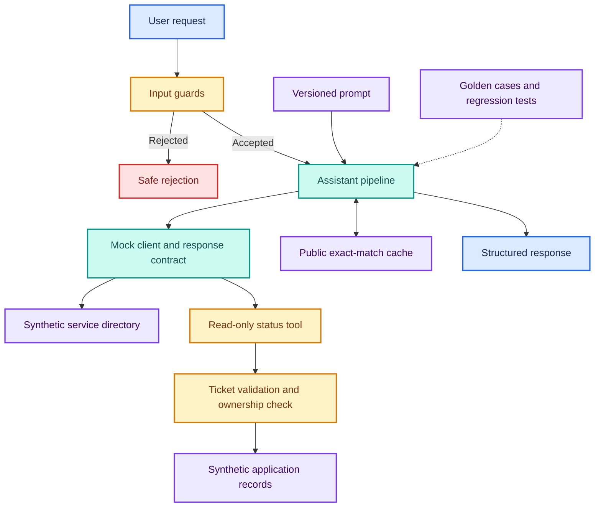
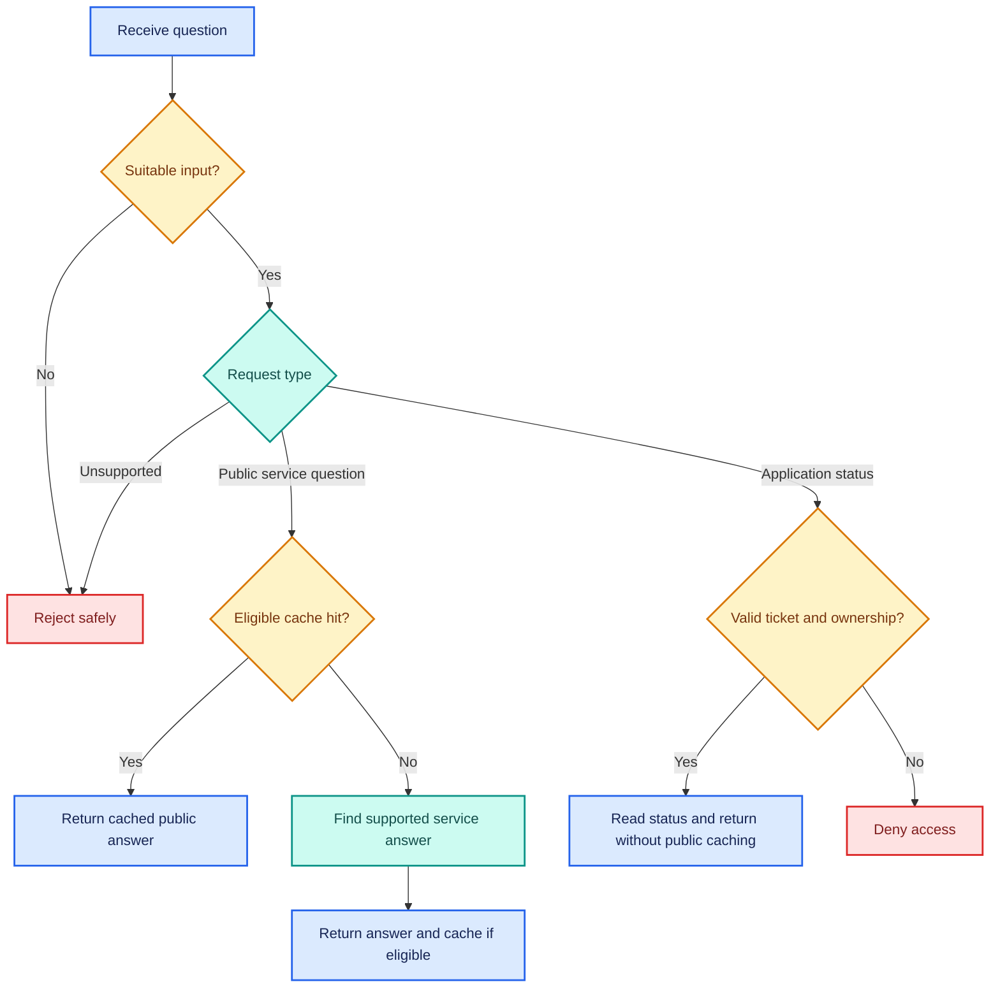
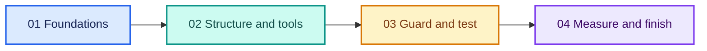
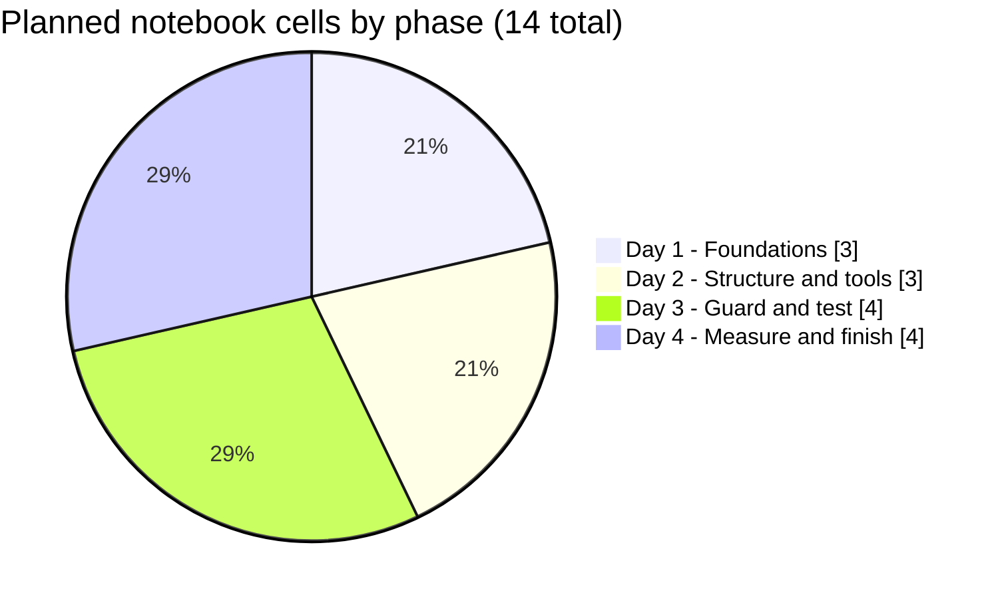
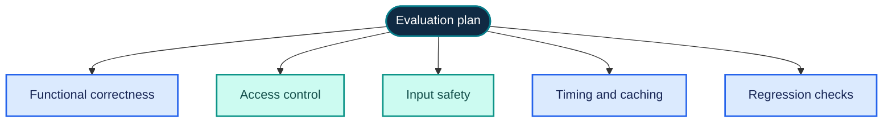

@@ -1 +1,265 @@
# murshid.ipynb_Setah_SDAIA

MURSHID | مرشد

A Safe, Context-Aware Service Assistant

Reliable answers. Controlled access. Measurable behavior.

Python
Colab
LLM
SDAIA Academy
Status

SDA-AIE-213 · LLM Application Engineering · SDAIA Academy

Prepared by Setah Saad

📌 Project at a Glance

Roadmap
Cells
Tests
Data

|🛡️ Safety    |🔐 Access control|⚡ Efficiency|🧪 Reliability|
|:----------:|:--------------:|:----------:|:-----------:|
|Input guards|Ownership checks|Public cache|Golden cases |

Overview · Architecture · Workflow · Roadmap · Evaluation

01 | Project Overview

Murshid is an educational service-assistant prototype designed to answer known service questions, retrieve application status through an authorized read-only tool, and reject unsuitable or unsupported requests.

The project explores how to engineer reliable LLM-style applications using structured responses, controlled tool access, guardrails, evaluation, and safe caching. The core implementation follows a mock-client approach using synthetic data rather than a production LLM or a live customer database.

02 | Problem & Solution

|Challenge                                 |Murshid’s design approach                            |
|------------------------------------------|-----------------------------------------------------|
|Unsupported or off-topic questions        |Restrict responses to supported service information  |
|Unauthorized access to application records|Validate requests and verify ownership               |
|Inconsistent responses                    |Use a defined response contract and versioned prompts|
|Repeated public questions                 |Reuse eligible answers through exact-match caching   |
|Unexpected behavior after changes         |Use golden cases and regression testing              |

03 | Key Features

● Grounded service answers: respond using a synthetic service directory.

● Structured responses: follow a defined response contract.

● Authorized status lookup: validate tickets and check ownership before returning status.

● Guardrails: reject unsuitable inputs and unsupported requests.

● Prompt versioning: maintain a versioned prompt artifact.

● Evaluation: use ten golden cases and regression checks.

● Safe caching: cache eligible public answers only, not private application-status responses.

These features describe the course project scope; implementation and test completion are to be verified against the final notebook.

04 | System Architecture

The following conceptual diagram illustrates the intended components and access boundaries.

05 | Request Workflow

> The diagrams are conceptual, not a verified trace of the final notebook’s execution order.

06 | Technology Stack

|Technology / concept|Role                                     |
|--------------------|-----------------------------------------|
|Python 3            |Core application logic                   |
|Google Colab        |Development and execution environment    |
|Mock client         |Simulated model behavior                 |
|JSON                |Structured artifacts and result export   |
|Mermaid             |Architecture and workflow documentation  |
|GitHub              |Project documentation and version control|

The core course project uses a CPU runtime and requires no additional installation. Real-model exercises are separate optional extensions.

07 | Development Roadmap

|Phase|Focus                                                      |Notebook cells|
|-----|-----------------------------------------------------------|--------------|
|Day 1|Synthetic directory, mock client, `ask`, response contract |1–3           |
|Day 2|Ticket validation, read-only status lookup, ownership check|4–6           |
|Day 3|Versioned prompt, guards, pipeline, ten golden cases       |7–10          |
|Day 4|Public exact cache, measurements, regression, export       |11–14         |

📊 Planned notebook structure

The chart shows the course’s planned cell allocation, not implementation progress or measured performance.

08 | Getting Started

1. Open the project’s cumulative .ipynb notebook in Google Colab.

2. Select a Python 3 CPU runtime (no accelerator).

3. Run the notebook cells in order, from the foundations through the final evaluation.

4. Inspect the responses, test outcomes, measurements, and exported artifacts.

The final notebook filename and direct link will be added after upload.

09 | Example Scenarios

Illustrative scenarios, not recorded execution outputs:

|Scenario                                     |Expected behavior                     |
|---------------------------------------------|--------------------------------------|
|Ask a supported service question             |Return a grounded service answer      |
|Ask for the status of an owned application   |Return the authorized status          |
|Request another user’s application status    |Deny access                           |
|Submit an unsuitable or out-of-scope question|Reject safely                         |
|Repeat an eligible public question           |Reuse the cached answer when available|

10 | Evaluation & Results

|Evaluation area       |Measurement / evidence                |Result              |
|----------------------|--------------------------------------|--------------------|
|Functional correctness|Ten golden cases                      |Pending verification|
|Access control        |Ownership and ticket-validation checks|Pending verification|
|Safety                |Unsuitable-input rejection checks     |Pending verification|
|Performance           |Response timing and cache measurements|Pending verification|
|Regression            |Re-run tests after changes            |Pending verification|

Evaluation coverage map

No measured scores or performance improvements are claimed until the final notebook has been executed and its results reviewed.

11 | Future Improvements

● Integrate a real language model and compare its behavior with the mock client.

● Expand evaluation coverage for ambiguous and adversarial requests.

● Explore Arabic and English service interactions.

● Add a user-facing interface and more detailed observability.

These are proposed extensions, not completed features.

12 | Acknowledgments

Developed by Setah Saad as a learner project for the LLM Application Engineering Program (SDA-AIE-213) at SDAIA Academy, based on the guided four-day course by Meaad Al-Marri.

Special thanks to SDAIA Academy and Meaad Al-Marri for their guidance and support throughout this learning journey.

Official academy GitHub: @SDAIAAcademy

Original course repository

MURSHID | Engineering reliable AI-style service experiences.

